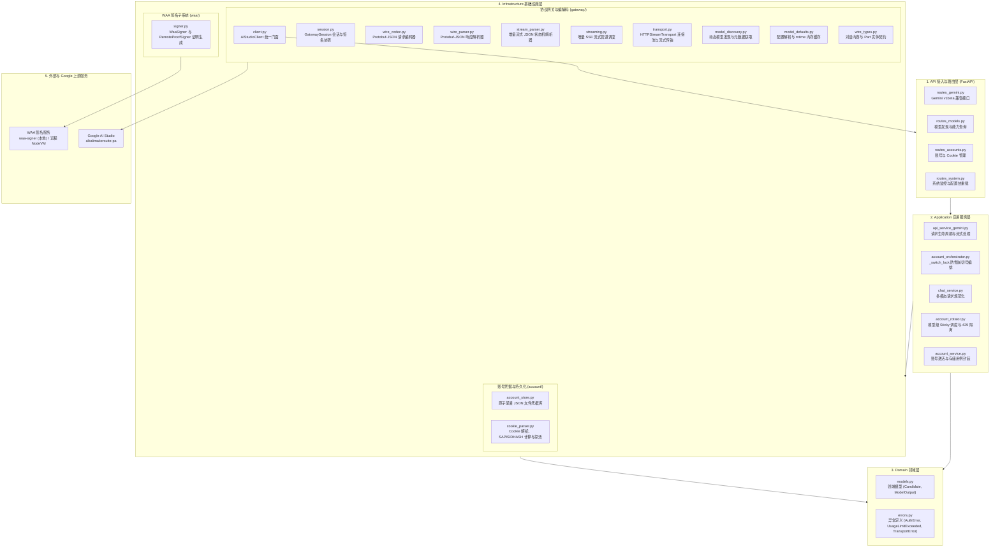
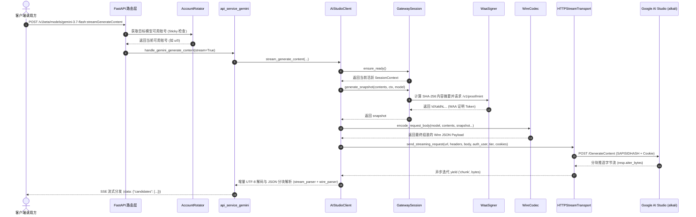

# aistudio-api 系统架构设计

本文档说明 `aistudio-api` 反向代理服务的整体系统架构、各模块职责分工、数据流转管线以及并发调度与反爬绕过机制。

---

## 目录

- [1. 整体架构与分层设计](#1-整体架构与分层设计)
- [2. 核心模块与职责划分](#2-核心模块与职责划分)
- [3. 请求生命周期与执行时序](#3-请求生命周期与执行时序)
- [4. 并发控制与高可用设计](#4-并发控制与高可用设计)
- [5. 跨平台支持与依赖隔离](#5-跨平台支持与依赖隔离)

---

## 1. 整体架构与分层设计

系统采用分层设计（Layered Architecture），划分为 **API 接入层**、**Application 应用服务层**、**Domain 领域层** 与 **Infrastructure 基础设施层**：

---

## 2. 核心模块与职责划分

### 2.1 API 接入层 (`src/aistudio_api/api/`)

| 文件 | 核心职责 |
|---|---|
| `routes_gemini.py` | 对外暴露 `/v1beta/models/{model}:generateContent` 和 `:streamGenerateContent` 端点 |
| `routes_models.py` | 动态向上游拉取并缓存可用模型列表（如 `gemini-3.7-flash`、`gemini-3.8-flash` 等） |
| `routes_accounts.py` | 提供 Cookie 单条/Bundle文件导入、多账号递归探活（`u/0`, `u/1`...）、手动激活与删除接口 |
| `routes_system.py` | 监控指标查询、在线编辑与热重载 `config.yaml` 规则 |
| `dependencies.py` | 统一 API Key 鉴权拦截（支持 Query 参数 `?key=`、Header `x-goog-api-key`、`x-api-key` 或 `Bearer`） |

### 2.2 应用服务层 (`src/aistudio_api/application/`)

| 文件 | 核心职责 |
|---|---|
| `chat_service.py` | 将客户端提交的 Gemini 请求转换为内部结构，处理 Base64 媒体、系统提示与工具参数声明 |
| `account_rotator.py` | 负责多账号的 Sticky 黏性调度，按模型维护 429 限流与 403 鉴权异常隔离状态，每日美西午夜重置 |
| `account_orchestrator.py` | 提供全局防雪崩互斥锁（`_switch_lock`），在并发 429 与 403 异常时实现安全有序故障转移切号与单账号在位自愈 |
| `account_service.py` | 账号领域用例（Cookie 保存、批量探活导入、凭据激活）封装，杜绝路由层穿透访问存储私有属性 |
| `api_service_gemini.py` | 编排请求全生命周期，协调 WAA 签名、HTTP/2 流式传输及 SSE 响应 |

### 2.3 领域模型层 (`src/aistudio_api/domain/`)

| 文件 | 核心职责 |
|---|---|
| `models.py` | 领域数据结构定义（`Candidate`, `ModelOutput`, `GeneratedImage`），不耦合外部 Protobuf 数组下标 |
| `errors.py` | 异常体系定义（`SessionExpiredError`, `AuthError`, `UsageLimitExceeded`, `RequestError`, `TransportError` 等） |

### 2.4 基础设施层 (`src/aistudio_api/infrastructure/`)

- **WAA 签名子系统 (`waa/`)**：
  - `signer.py`：提供 `extract_content_digest` 内容哈希计算、`RemoteProofSigner` 证明请求客户端以及 `WaaSigner` 门面。支持在 `config.yaml` 中配置多签名服务节点（本地 Go 原生引擎 `waa-signer` 或远程 NodeVM 签名服务），纯手动切换，并自动将签名服务绑定的特征 `User-Agent` 与特征请求头同步到外层 HTTP 传输中。
- **网关与编解码子系统 (`gateway/`)**：
  - `client.py`：`AIStudioClient` 统一门面，组装请求签名、HTTP 发送、流式生成与会话生命周期。
  - `session.py`：`GatewaySession` 与 `SessionContext` 核心，管理内存态账号上下文切换、WAA 快照签名生成与 HTTP 传输路由。
  - `wire_spec.py`：Protobuf-over-JSON (JSPB) 字段索引枚举与 `JspbArray` 稀疏容器定义。
  - `wire_codec.py`：JSPB 请求结构直接编码、参数组装与内置工具注入。
  - `wire_parser.py`：JSPB 响应解析器，处理 Struct 结构体、ListValue 数组与状态码映射。
  - `wire_types.py`：领域数据结构契约（`AistudioContent`、`AistudioPart`、`AistudioGenerationConfig`）。
  - `stream_parser.py`：流式 JSON 增量状态机解析器，去除 XSSI 前缀并按括号深度切片分块。
  - `transport.py`：`HTTPStreamTransport` HTTP 传输层，基于 `httpx.AsyncClient` 连接池与异步字节流读取，保证流式响应在结束或异常时关闭底层流并上报具体异常类型。
  - `streaming.py`：流式响应增量 UTF-8 解码、分块解析与传输异常（`TransportError`）映射。
  - `model_discovery.py`：可用模型列表动态探测与本地降级。
  - `model_defaults.py`：模型默认规则解析与 mtime 驱动的内存缓存。
- **账号与持久化子系统 (`account/`)**：
  - `account_store.py`：账号凭据持久化存储（通过临时文件原子替换保障并发安全）。
  - `cookie_parser.py`：Cookie 格式解析、精简过滤、`auth.json`/`meta.json` 读取、`SAPISIDHASH` 鉴权头计算与多子账号递归探测。
## 3. 请求生命周期与执行时序

从客户端请求到获取流式响应的端到端调用时序：

## 4. 并发控制与高可用设计

### 4.1 异步连接池与增量流式解析

- 通过 `HTTPStreamTransport` 维护共享 `httpx.AsyncClient` 连接池。
- 流式请求通过 `codecs.getincrementaldecoder("utf-8")` 与 `IncrementalJSONStreamParser` 进行增量解码与括号深度切块，避免多字节 UTF-8 字符跨 chunk 截断乱码。
### 4.2 模型独立限流、403 鉴权隔离与 Sticky 调度

- **模型级配额隔离**：各账号针对不同模型（如 `gemini-3.7-flash`、`gemini-3.8-flash`）的 429 状态独立记录，单模型额度耗尽不影响其他模型的正常调用。
- **403 鉴权异常快速避让与自愈**：当账号遭遇 `The caller does not have permission` (403) 异常时，调度器立即对该账号增加动态调度惩罚权重（`auth_errors * 200.0`），优先调度至健康备用账号；若无备用号则触发在位会话刷新与重新签名自愈。
- **Sticky 黏性调度**：默认保持当前活跃账号，直到该账号针对当前模型遭遇 429 限流或 403 异常时，才自动顺延切换至下一个健康账号。
- **自动配额重置**：每日美西时间午夜（00:00 PST / 16:00 CST）自动重置 RPD 限制，无需重启服务。

### 4.3 防切号雪崩互斥锁 (`_switch_lock`) 与自愈

当多个并发协程同时遭遇 429 限流或 403 权限异常时：
1. 率先获得 `_switch_lock` 的协程执行实质性切号与内存会话上下文切换；
2. 后续排队获得锁的协程通过双重检查（Double-Checked Locking），识别到账号已被切换至健康账号且对当前模型可用，直接复用重试，避免并发异常导致多次无谓切号；
3. 若为单账号或备用账号全部耗尽时，系统自动对当前账号触发在位会话刷新（In-Place Refresh）并重新签名重试。

### 4.4 会话切换与请求上下文绑定

在多账号并发场景下，`GatewaySession` 维护请求级凭据隔离：
1. **内存上下文切换**：触发账号轮换时，`GatewaySession.transition_to_account` 从目标账号的 `auth.json` 与 `meta.json` 加载 Cookie、`auth_user` 与 `tier`，构造新的 `SessionContext`；
2. **请求上下文绑定**：每个 `PreparedRequest` 在签名时绑定当时的 `SessionContext`，后续 HTTP 传输直接使用该上下文的凭据，避免并发切号期间跨账号串号。

## 5. 跨平台支持与依赖隔离

| 平台 | 运行模式 | 传输与签名后端 | 内存基准 |
|---|---|---|---|
| **Android (Termux)** | Termux 原生宿主运行 | `httpx` (HTTP/2) + `WaaSigner` (本地 Go 或远程 NodeVM) | 约 35 - 50 MB |
| **Linux (x86_64 / arm64)** | 原生宿主运行 | `httpx` (HTTP/2) + `WaaSigner` (本地 Go 或远程 NodeVM) | 约 35 - 50 MB |
| **macOS (Apple Silicon / Intel)** | 原生宿主运行 | `httpx` (HTTP/2) + `WaaSigner` (本地 Go 或远程 NodeVM) | 约 35 - 50 MB |
| **Windows (x64)** | 原生宿主运行 | `httpx` (HTTP/2) + `WaaSigner` (本地 Go 或远程 NodeVM) | 约 40 - 60 MB |
| **Docker 容器** | `python:3.11-slim-bookworm` (amd64 / arm64) | `httpx` (HTTP/2) + `WaaSigner` (本地 Go 或远程 NodeVM) | 约 35 - 50 MB |
> 依赖管理使用 `uv`。由于 PyPI 官方未提供 Android 预编译 wheel，而 Termux 的 TUR 源缺少桌面端 wheel，因此 `uv.lock` 不纳入版本控制：桌面端直接从 PyPI 安装对应 wheel；Termux 环境通过本地 `uv.toml` 使用 TUR 源，避免不同平台的 wheel 源锁定冲突。
