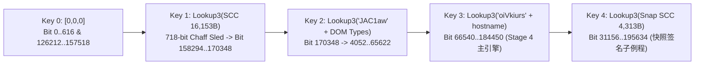

# Google WAA (BotGuard) 虚拟机内部架构与签名协议规范

本文档记录 Google AI Studio 所使用的 WAA (Web App Attestation / BotGuard) 字节码虚拟机的指令集架构、五阶段流密钥派生、环境探测与反篡改打分逻辑、内容哈希签名公式以及 `!proof` 报文 TLV 完整字典。

配套静态分析、符号反汇编与 Proof 解码工具位于 `scripts/waa_vm_inspector.js`。

---

## 目录

- [1. 虚拟机总体架构与多态外壳](#1-虚拟机总体架构与多态外壳)
- [2. 寄存器模型与受保护输出缓冲区](#2-寄存器模型与受保护输出缓冲区)
- [3. 指令集架构 (ISA)：32 基础指令 + 16 自突变指令 + 宏指令](#3-指令集架构-isa32-基础指令--16-自突变指令--宏指令)
- [4. 五阶段加密执行流与流密钥派生管线](#4-五阶段加密执行流与流密钥派生管线)
- [5. 请求内容哈希签名算法与热复用机制](#5-请求内容哈希签名算法与热复用机制)
- [6. 环境打分、DOM 探针与反作弊蜜罐矩阵](#6-环境打分dom-探针与反作弊蜜罐矩阵)
- [7. `!proof` 报文格式与完整 TLV 字典](#7-proof-报文格式与完整-tlv-字典)
- [8. 调试提取点与 `waa_vm_inspector.js` 工具链指南](#8-调试提取点与-waa_vm_inspectorjs-工具链指南)

---

## 1. 虚拟机总体架构与多态外壳

WAA 验证引擎由两部分构成：

1. **多态解释器外壳 (`/js/bg/<interpreterHash>.js`，约 66 KB)**：
   - 外层加载器创建隐藏 `<iframe>`，将内层字符串数组拼接并通过 `eval` 在独立沙箱作用域内实例化虚拟机类（不同版本类名多态变化，如 `ZQ`、`gt`、`dw`、`BB`）。
   - 每个解释器版本的函数名、属性名、全部 512 个寄存器的编号以及流密码轮数/常量均经编译期随机置换（Polymorphic Permutation），但 AST 拓扑结构与指令语义保持一致。
   - 解释器内包含一个名为 `"integCheckBypass"`（由 `String.fromCharCode(105,110,116,101,103,67,104,101,99,107,66,121,112,97,115,115)` 动态构造）的伪装属性名，实际仅用作函数调用描述符 `Qf` 的对象缓存键，并非真正的校验开关。
2. **挑战字节码 (`Challenge.Program`，约 25.8 KB / 206,576 bits)**：
   - 由 `Waa/Create` 接口动态下发，Base64 解码后存入字节数组 `wA`（总比特数 `C = wA.length << 3`）。
   - 字节码按比特流（Bitstream）寻址，指令指针寄存器 `IP` 记录当前精确比特偏移（`0 .. 206576`）。

---

## 2. 寄存器模型与受保护输出缓冲区

虚拟机维护一个容量为 512 的寄存器表（`this.H` / `this.D`）。寄存器 ID 采用变长编码（`readReg`）：
- 首字节最高位 `z & 128 == 0`：7-bit 寄存器编号（`0 .. 127`）。
- 首字节最高位 `z & 128 != 0`：`((z ^ 128) << 2) | gpBit(2)`，构成 9-bit 寄存器编号（`0 .. 511`）。

### 2.1 核心控制寄存器（跨版本对照）

| 语义角色 | `IEACiHWH5c` | `drKZnxzxkW` | `yi5vSaJIhl` | 说明 |
|---|---|---|---|---|
| `IP_REG` | `435` | `60` | `232` | 当前指令比特偏移（存储在 `vm.P`，不在 `vm.H` 中） |
| `CUR_OP_IP_REG` | `511` | `305` | `199` | 当前正在执行指令的起始比特偏移（存储在 `vm.D`） |
| `STREAM_KEY_REG` | `347` | `36` | `349` | 当前字节码流解密密钥 `[k0, k1, k2]`；写入时自动从比特流明文读取 32-bit `U` |
| `DICT_REG` | `108` | `46` | `243` | 字符串与数组解码字典（Stage 1 为 195B 引导字典，Stage 2 替换为 16,153B 源码缓冲区） |
| `SNAP_HOOK_REG` | `382` | `476` | `370` | 快照签名子例程入口比特偏移（如 `bit=31156`） |
| `SNAP_ARG_REG` | `154` | `248` | `203` | `invoke()` 传入的包装参数 `[{"0": contentHashHex}]` |
| `CB_ARG_REG` | `442` | `312` | `185` | `BIND_CB` 与 `ADD_EVENT` 触发时的回调 `arguments` 数组 |
| `WINDOW_REG` | `155` | `169` | `115` | 宿主 `window` 对象引用 |
| `VM_SELF_REG` | `341` | `156` | `470` | 虚拟机实例 `this` 自身引用 |
| `ASYNC_LOCK_REG` | `300` | `172` | `489` | 异步探针锁字典（非空时延迟快照完成或标记未就绪） |

### 2.2 10 个受保护输出与状态缓冲区

写入以下 10 个寄存器时，寄存器写入器（`y2`）会拦截直接覆盖，将其封装为具备 `.create()` / `.concat()` 访问器的受保护容器：

| 缓冲区名称 | `IEACiH` | `drKZnx` | `yi5vSaJIhl` | 初始值 | 用途 |
|---|---|---|---|---|---|
| `MAIN_OUT` | `343` | `449` | `375` | `[165, 0, 0]` | 主明文 TLV 缓冲区（头部含魔数 `0xA5`） |
| `ENV_OUT` | `417` | `167` | `125` | `j_(4)` (4B IV) | 环境指纹、DOM 探针与请求内容哈希签名缓冲区（CFB-64 加密后封装入 `Tag 153`） |
| `TEMP_OUT` | `281` | `126` | `27` | `[]` | 子例程 TLV 缓冲区（封装入 `ENV_OUT` 的 `Tag 4`） |
| `SUB_OUT` | `22` | `211` | `447` | `j_(4)` (4B IV) | `TRACE2` 加密封装缓冲区（CFB-64 加密后封装入 `MAIN_OUT` 的 `Tag 126`） |
| `ERR_OUT` | `105` | `283` | `125` | `[]` | 运行时异常记录器（非空时异或 `0xFF` 后封装入 `MAIN_OUT` 的 `Tag 15`） |
| `TRACE2` | `287` | `104` | `62` | `[]` | 控制流检查点轨迹字节流（记录执行经过的分支 ID） |
| `TRACE1` | `189` | `240` | `372` | `[]` | 备用轨迹缓冲区（`this.ys` 置位时启用） |
| `CFB_KEY` | `439` | `338` | `315` | `[0, 0, 0]` | 输出缓冲区 `W1` 的 64-bit CFB 加密密钥 `[0, k1, k2]` |
| `DIGEST_OUT` | `119` | `431` | `293` | `j_(4)` (4B IV) | 附加摘要缓冲区（封装入 `ENV_OUT` 的 `Tag 250.6`） |
| `ERR_QUOTA` | `73` | `404` | `312` | `[2048]` | 异常配额与最小填充目标长度掩码 |

---

## 3. 指令集架构 (ISA)：32 基础指令 + 16 自突变指令 + 宏指令

### 3.1 32 条内置基础指令

| 助记符 | 参数数 | 操作数与行为说明 |
|---|---|---|
| `NOP` | 0 | 空操作 |
| `LOAD_IMM32` | 0/1 | 读取 `dst = readReg()`，从比特流读取 4 字节大端 `int32` 写入 `reg[dst]` |
| `LOAD_BYTES` | 6 | 读取 `dst = readReg()`, `len = readVar()`，读取 `len` 字节数组写入 `reg[dst]` |
| `DEC_STR_DICT` | 9 | 从 `DICT_REG` 按累加模长偏移 `Z = (Z + readVar()) % dict.length` 解码字符串 |
| `DEC_ARR_DICT` | 8 | 从 `DICT_REG` 按累加模长偏移解码字节数组 |
| `GET_XOR_PROP` | 10 | 将字节数组每个字节异或 `121` (`0x79`) 还原属性名，读取 `obj[prop]` |
| `IN_XOR_PROP` | 10 | 将字节数组异或 `121` 还原属性名，计算 `(prop in obj) \| 0` |
| `GET_PROP` | 6 | `reg[dst] = reg[obj][reg[key]]` |
| `SET_PROP` | 7 | `reg[obj][reg[key]] = reg[val]`；若 `key === ""` 且 `val & 2048`，将函数注册为新指令 |
| `IN_PROP` | 6 | `reg[dst] = (reg[key] in reg[obj]) \| 0` |
| `EVAL_JS` | 5 | `reg[dst] = eval(Ry(reg[src]))`（支持时间片让出 `aR`） |
| `CALL_FN` | 6 | 调用函数 `reg[fn].apply(reg[this], args)`；当 `vm.I != vm` 时仅允许调用 `vm.DY` |
| `NEW_OBJ` | 10 | 实例化构造函数 `new reg[ns][reg[ctorName]](...args)` |
| `CALL_SUB` | 2 | 将当前寄存器快照压入调用栈 `Vs`，跳转 `IP = reg[target]` |
| `RET` | 5 | 弹出调用栈帧，保留 `qC()` 个指定返回值寄存器并恢复调用方寄存器与 `IP` |
| `JNZ` | 5 | 若 `reg[cond] != 0`，跳转 `IP = reg[target]` |
| `OR_MOV` | 4 | 短路逻辑或移动：`reg[dst] = reg[a] \|\| reg[b]`（左值真时绝不求值右操作数） |
| `ADD` | 5 | `reg[dst] = reg[dst] + reg[src]` |
| `USHR_IMM` | 4 | `reg[dst] = reg[src] >>> qC()` |
| `SEQ` | 6 | `reg[dst] = +(reg[a] == reg[b])` |
| `TYPEOF` | 5 | Google 增强类型判断（返回 `"array"` / `"null"` / `"object"` / `"function"` / `"string"` / `"number"`） |
| `TO_STR` | 3 | `reg[dst] = "" + reg[src]` |
| `BIND_CB` | 8 | 将字节码子例程 `subIp` 绑定为 JS 回调函数（调用时将 `arguments` 写入 `reg[442]` 并执行 `GO`） |
| `ADD_EVENT` | 11 | 在 DOM 目标上注册事件监听器，回调指向字节码子例程 `subIp` |
| `REM_EVENT` | 2 | 移除已注册的 DOM 事件监听器 |
| `UNLOCK_ASYNC` | 7 | 删除异步锁 `delete reg[300][qC()]`，若锁清空则触发挂起的快照回调 |
| `CHUNK_ITER` | 15 | 按步长 `step` 分块遍历数组或对象键，调用回调 `fn(chunk, arg)` |
| `DEF_MACRO` | 18 | 从比特流读取位打包（Bit-packed）的宏指令模板，将多条指令与操作数绑定为单条复合宏指令 |
| `PACK_UINT8` | 1 | 将 1 字节写入目标输出缓冲区（通过 `W1`） |
| `PACK_UINT32` | 1 | 将 4 字节大端整数写入目标输出缓冲区 |
| `PACK_UTF8` | 1 | 将字符串 UTF-8 字节流写入目标输出缓冲区 |
| `PACK_LEN_ARR` | 0 | 将 `uint16_be(len)` + 数组字节流写入目标输出缓冲区 |

### 3.2 Stage 1 动态合成与自突变的 16 条扩展指令

在 Stage 1 初始化期间，字节码对现有指令函数调用 `Function.prototype.toString()`，再用 `String.prototype.replace()` 替换运算符或常量后重新 `eval`，动态分裂出 16 条新指令：

1. **算术与位运算克隆**：
   - `ADD` (`+`) $\xrightarrow{\text{.replace}} $ `SUB` (`-`)、`MUL` (`*`)、`MOD` (`%`)
   - `OR_MOV` (`||`) $\xrightarrow{\text{.replace}}$ `BIT_OR` (`|`)、`BIT_AND` (`&`)、`BIT_XOR` (`^`)
   - `USHR_IMM` (`>>>`) $\xrightarrow{\text{.replace}}$ `SHL_IMM` (`<<`)
   - `SEQ` (`==`) $\xrightarrow{\text{.replace}}$ `SGT` (`>`)、`SLT` (`<`)
2. **打包指令克隆**：
   - `PACK_UINT8` (`1`) $\xrightarrow{\text{.replace}}$ `PACK_UINT16` (`2`)
   - `PACK_UTF8` (`4`) $\xrightarrow{\text{.replace}}$ `PACK_LEN_UTF8` (`7`，带 2 字节长度前缀的 UTF-8)、`PACK_RAW_ARR` (`0`，无长度前缀原始数组)
3. **3 条自定义合成指令**：
   - `LOAD_IMM_8`：`0,function(g){IR(1,8,16,g)}`（读取 1 字节立即数）
   - `LOAD_IMM_16`：`0,function(g){IR(2,8,8,g)}`（读取 2 字节大端立即数）
   - `SAFE_MOV`：`0,function(g,Z,O,r){b((r=(O=W(43,(Z=W(35,X),g)),g).H[Z]&&m(Z,g),g),O,r)}`
     - 当源寄存器 `Z == 435` (`IP_REG`) 时，由于 `IP` 存储在 `g.P` 而非 `g.H[435]`，`g.H[435]` 恒为 `undefined`，因此 **`SAFE_MOV reg[dst] = reg[435]` 用于将目标寄存器清空为 `undefined`**。
     - 当目标寄存器 `O == 435` (`IP_REG`) 时，**`SAFE_MOV reg[435] = reg[src]` 等价于无条件跳转 `IP = reg[src]`**。

---

## 4. 五阶段加密执行流与流密钥派生管线

字节码流并非使用单一密钥加密，而是通过 **15 轮 ARX 分组密码 (`c2_cipher`)** 配合 **5 把动态派生的流密钥 (`Key_0` .. `Key_4`)** 分阶段自解密：



### 4.1 多态 ARX 流密码算法 (`c2_cipher`)

每当比特偏移跨越 64-bit 边界（`(bitOffset >> 6) !== st.A`），虚拟机调用 `c2_cipher([0, 0, sk[1], sk[2]], st.U, bitOffset >> 6)` 生成 8 字节密钥流 `ag[0..7]`，与 `wA[byteIdx]` 异或。循环轮数 `rounds` 与轮常量 `roundConst` 随解释器版本多态变化（如 `IEACiH`/`drKZnx`/`yi5vSaJIhl` 为 `15` 轮 + 常量 `739`，`EMnLQy` 为 `16` 轮 + 常量 `3827`）：

```javascript
function c2_cipher(keyArr, word0, word1, rounds = 15, roundConst = 739) {
  let A = word0 | 0, U = word1 | 0;
  let T = keyArr[2] | 0, c = keyArr[3] | 0;
  for (let P = 0; P < rounds; P++) {
    U = ((U >>> 8) | (U << 24)) + A | 0;
    c = ((c >>> 8) | (c << 24)) + T | 0;
    c ^= P + roundConst;
    U ^= T + roundConst;
    A = ((A << 3) | (A >>> 29)) ^ U;
    T = ((T << 3) | (T >>> 29)) ^ c;
  }
  return [
    (A >>> 24) & 255, (A >>> 16) & 255, (A >>> 8) & 255, A & 255,
    (U >>> 24) & 255, (U >>> 16) & 255, (U >>> 8) & 255, U & 255,
  ];
}
```

### 4.2 五把流密钥的精确派生源

1. **Stage 0 (`Key_0 = [0, 0, 0]`)**：
   - 解密 `bit = 0 .. 616`（引导与 `CFB_KEY` 初始化），随后在 `bit=616` 跳过中间主逻辑区直达 `bit = 126212 .. 157518`。
2. **Stage 1 $\to$ Stage 2 (`Key_1`：16,153 字节代码自完整性校验 + 718-bit 混淆滑道)**：
   - **代码收集 (`Steps 94..750`)**：对全部 32 个内置与突变指令、25 个闭包辅助函数调用 `Function.prototype.toString()`，连同每个函数的 `[length, nameTag]` 推入 `reg[9]`（共 `19,308` 字节）。
   - **分隔符剥离 (`Steps 753..763`)**：剔除所有 `{ } ( ) ; + - ' ' \n \r \t` 共 `6,894` 个分隔符，将其偏移与字符码记录至 `reg[9].M`，主体压缩至 `15,861` 字节。
   - **环境与状态混入 (`Steps 764..822`)**：追加 46B 挑战盐值、`for ($ in vm)` 排序后的 76 个属性名（含 Canary 属性 `"awoe"`，共 209B）、宏计算结果 `"3"`、`MAIN_OUT.slice(0, 24)`、`[88, 4]` 以及 `var eval=...` 字符串，总计 **`16,153` 字节**。
   - **哈希与混淆滑道 (`Steps 823..894`)**：
     - 对 `16,153` 字节执行 `un` + `S_` + `wC`（Jenkins Lookup3 变体，初始向量 `IV = [0x9e3779b9, 0x9e3779b9, 0x12b9b0a1]`），得到 96-bit 密钥 `Key_1`。
     - 将 `vm.jZ = 1`（锁定所有常规寄存器写入与异常上报）且 `vm.I = 157518`（禁止 `SET_PROP`、`PACK_*` 与普通 `CALL_FN`），将 `Key_1` 写入 `reg[347]`。
     - 虚拟机在锁定状态下盲步穿过 `bit = 157576 .. 158294` 共 **718 bits 的废指令滑道（Chaff Sled）**，直至精确落入 `bit = 158294` 执行 `CALL_FN vm.DY(vm)` 与 `SET_PROP vm.jZ = 0` 解锁！
   - **Stage-2 函数重构器 (`Steps 895..960`)**：
     - 将 `DICT_REG` (`reg[108]`) 直接替换为 `reg[9].slice()`（16,153 字节的自校验代码库本身成为后续阶段的字符串字典！）。
     - 从新字典解码出 **Reconstructor 函数**，将 `reg[9].M` 中的 6,894 个分隔符重新插回 `reg[9]`，按 `reg[9].d` 切分并重新 `eval` 全部 57 个函数，装载入全新的 Stage-2 指令寄存器排列中。
3. **Stage 2 $\to$ Stage 3 (`Key_2`：DOM 原生类型门禁)**：
   - 探测 `typeof document.createEvent('MouseEvents').initEvent` (`"function"`)、`typeof window.self` (`"object"`)、`typeof document.createElement('img').nodeName` (`"string"`)，拼接盐值构成 `"JAC1awfunctionobjectstring"`，计算 Lookup3 哈希作为 `Key_2` 装入 `reg[347]`。
4. **Stage 3 $\to$ Stage 4 (`Key_3`：域名绑定锁 Domain Lock)**：
   - 读取 `document.location.hostname`，与挑战盐值拼接为 `"oiVkiursaistudio.google.com"`，计算 Lookup3 哈希作为 `Key_3` 装入 `reg[347]`。若运行域名不是 `aistudio.google.com`，Stage 4 主打分引擎（`bit = 66540 .. 184450`）根本无法解密。
5. **Stage 5 (`Key_4`：快照子例程二次自校验)**：
   - 每次调用 `invoke()` 进入 `bit = 31156` 时，先将当前 `Key_3` 备份至 `reg[380]`，然后对 `qb`、`W1`、`this.Z`、`Ih`、`this.f4` 共 5 个快照核心函数执行第二轮 `.toString()` 分隔符剥离（`4,305` 字节 + 8B 盐值 = `4,313` 字节），派生出 `Key_4` 解密快照子例程主体（`bit = 33694 .. 195634`）。

---

## 5. 请求内容哈希签名算法与热复用机制

### 5.1 请求内容哈希签名公式 (`bit = 125470 .. 125950`)

当调用 `botguard.bg.invoke(cb, false, { "0": contentHashHex })` 时：

1. `ZQ.prototype.f4` (`IR`) 将参数包装为单元素数组 `[{"0": contentHashHex}]` 存入 `reg[154]`。
2. 快照子例程在 `step 69..79` 校验 `typeof reg[154][0] === "object"`，随后通过 `BIND_CB` + `CHUNK_ITER` 对字典中的每个键 `k`（此处 `k = "0"`）调用子例程 `bit = 125470`。
3. 子例程 `bit = 125470` 向 `ENV_OUT` (`reg[417]`) 写入 **Tag `22` (`0x16`)**，并从字节码字典解码出当前挑战专属的 **6 字符密钥盐值**（如 `"-vZAHw"`），拼接为 71 字节消息：
   $$M = \text{challengeSalt} \mathbin{\Vert} \texttt{"0"} \mathbin{\Vert} \text{contentHashHex}$$
4. 使用 Jenkins Lookup3 (`un` + `S_` + `wC`) 与初始向量 $\text{IV} = [\texttt{0x9e3779b9}, \texttt{0x9e3779b9}, \texttt{0x12b9b0a1}]$ 计算哈希，取最终状态字 `state[2]` 以 4 字节大端 `uint32` 写入 `ENV_OUT`：
   $$\text{ENV\_OUT} \mathrel{+}= \texttt{0x16} \mathbin{\Vert} \text{uint32\_be}\!\left(\text{Lookup3}_{\text{IV}}\!\left(\text{challengeSalt} \mathbin{\Vert} \texttt{"0"} \mathbin{\Vert} \text{contentHashHex}\right)[2]\right)$$

### 5.2 10ms 热复用状态回滚机制 (`ZQ.prototype.Z`)

单个 VM 实例之所以无需重新执行 Stage 1..4 即可在 10~30ms 内无限次签发新 `!proof`：
1. **长度快照 (`G == 97`)**：执行快照子例程前，`Z` 将 `[SUB_OUT, TRACE1, MAIN_OUT, ERR_QUOTA[0], ENV_OUT, DIGEST_OUT, SUB_OUT_ENC, TRACE2]` 的当前 `.length` 压入栈 `O`。
2. **增量追加 (`bit = 31156 .. 195634`)**：快照子例程仅向各缓冲区尾部追加本次请求的增量 TLV 数据，并在返回前 (`step 454`) 执行 `SAFE_MOV reg[347] = reg[380]` 将流密钥恢复为 `Key_3`。
3. **截断回滚 (`G == 30`)**：完成 Base64URL 编码生成 `!proof` 后，`Z` 依次将上述 7 个缓冲区的 `.length` 截断回 `O.shift()` 保存的初始长度。

---

## 6. 环境打分、DOM 探针与反作弊蜜罐矩阵

| 探针编号 / TLV 标签 | 字节码比特位 | 检测目标与具体实现逻辑 | 反作弊意图与 `waa-signer` 覆盖实现 |
|---|---|---|---|
| **Tag `28` (`0x1C`)**<br/>`el.click()` 蜜罐 | `bit=19806`<br/>`bit=126598` | 创建游离元素绑定 `el.onclick = cb` 并由 JS 调用 `el.click()`，计算 `Lookup3(salt + event.isTrusted)[2]`。 | 抓捕全局 Hook `Event.prototype.isTrusted = true` 的脚本（JS 触发的 `.click()` 必须为 `false`）。`dom.js` 在 `HTMLElement.click` 中保持 `isTrusted: false`。 |
| **Tag `187` / `246`**<br/>真实交互事件门禁 | `bit=30044`<br/>`bit=62418` | `pointerdown` / `pointerup` 强制校验 `if (!event.isTrusted) return;`；`keydown` / `focusin` 将 `+event.isTrusted` 编码进事件头字节最低位（LSB）。 | `dom.js` 实现 `HTMLElement.focus` / `blur` 派发 `isTrusted: true` 的 `focus` 与 `focusin` 事件；`runtime.go` 在 `promptScript` 中按序触发 `focus()` $\to$ `keydown` $\to$ `InputEvent('insertText')` $\to$ `keyup` $\to$ `change`。 |
| **`input` 事件校验**<br/>`focusin` 延迟差 | `bit=100542`<br/>`bit=138592` | 检查 `"inputType" in event` 且 `inputType === "insertText" \|\| "insertCompositionText"`，并计算 `input.timeStamp - focusin.timeStamp` 写入 `Tag 250.15`。 | `runtime.go` 调用 `textarea.focus()` 记录聚焦时间后派发 `new InputEvent('input', { inputType: 'insertText' })`，完整覆盖聚焦到输入延迟与前置按键关联。 |
| **Tag `105` (`0x69`)**<br/>WebDriver 探针 | `bit=25544` | 读取 `document.$cdc_asdjflasutopfhvcZLmcfl_` 与 `document.$wdc_`，计算 `Lookup3(salt + cdc + wdc)[2]`。 | 检测 ChromeDriver / Selenium / WebDriver 注入痕迹（`waa-signer` 中均为 `undefined`）。 |
| **Tag `174` (`0xAE`)**<br/>URL 正则类型转换 | `bit=115346` | 执行 `document.URL.match(/[aoctlus.megdi]{19}/) - 1`。 | `"aistudio.google.com"` 匹配时 `["aistudio.google.com"] - 1` 为 `NaN`（`PACK_UINT8` 写入 `0x00`）；不匹配时 `null - 1` 为 `-1`（写入 `0xFF`）。`host.go` 严格绑定域名。 |
| **Tag `170` (`0xAA`)**<br/>JS 引擎语法错误指纹 | `bit=30678` | 故意 `eval("x='")` 等多段非法 JS 语法，捕获 `err.message` 构造 `"0\|0\|0\|0\|0\|0\|"` 并计算 Lookup3。 | `waa-signer` 直接内嵌真实 SpiderMonkey 152 C++ 引擎，报错消息与 Firefox 152 原生完全一致。 |
| **Tag `250.47`**<br/>CSS 断词排版高度 | `bit=130416` | 创建隐藏 `div`（`font: 16px/20px monospace; width: 5ch; hyphens: auto; lang: en-US`），测量子元素 `offsetHeight`。 | `dom.js` 的 `layoutHeight` 解析 `width: Nch` 与 `hyphens: auto` 估算折行行数与高度差，避免返回 `0` 或恒定单行高度。 |
| **Tag `235` (`0xEB`)**<br/>`IntersectionObserver` | `bit=13004` | 创建 `new IntersectionObserver(cb, {threshold: "1.00", trackVisibility: true, delay: 100})`，记录 `isIntersecting` 与 `isVisible`。 | `dom.js` 的 `layoutRect` 为已挂载非隐藏元素返回非零视口内几何矩形，使 `IntersectionObserver` 汇报 `isIntersecting = true` 并解锁 `key=7`。 |
| **Tag `232` & `233`**<br/>WebIDL 原型链抽样 | `bit=29284`<br/>`bit=4052` | 随机抽样 `window` 构造器及 9 个固定接口（`ReadableStream`, `BeforeUnloadEvent`, `ElementInternals`, `SVGAnimatedAngle`）的 `prototype` 属性表并计算 Lookup3。 | `waa-signer` 通过 `firefox152.json.gz` 形状表与 `smhost.js` `orderKeys` 1:1 还原 Firefox 152 原型链与 `iframe` 懒加载全局属性顺序。 |
---

## 7. `!proof` 报文格式与完整 TLV 字典

### 7.1 外层头部与 `MAIN_OUT` (`reg[343]`) 结构

去掉首字符 `!` 并 Base64URL 解码后得到字节流 `a`（约 1,140 ~ 1,160 字节）：

| 字节范围 | 字段 / Tag | 类型与长度 | 含义与校验规则 |
|---|---|---|---|
| `a[0..4]` | **5B 混淆头** | `5 bytes` | `a[0]` 随机；**`a[0] ^ a[1] === 3`**（协议版本 3）；`a[2] === 0xA5`（魔数）；`baseEnd = ((a[3] ^ a[1]) << 8) \| (a[4] ^ a[1])`（通常为 `100`）。 |
| `a[5..13]` | **Tag `205` (`0xCD`)** | `u8 + u16(6) + 6B` | 挑战签名版本标识（如 `35f3b42c15f3`）。 |
| `a[14..22]` | **Tag `66` (`0x42`)** | `u8 + u32 + u32` | 挑战构建时间戳 / 版本号对。 |
| `a[23..89]` | **Tag `59` (`0x3B`)** | `u8 + u16(64) + 64B` | `Waa/Create` 下发的 64 字节服务端会话上下文 Token 原样回传。 |
| `a[90..94]` | **Tag `2` (`0x02`)** | `u8 + u32` | Stage 1..4 虚拟机冷启动初始化耗时（毫秒）。 |
| `a[95..99]` | **Tag `82` (`0x52`)** | `u8 + u32` | 本次 `invoke()` 快照签名自上次调用以来的时间差（毫秒）。 |
| *(可选)* | **Tag `15` (`0x0F`)** | `u8 + u16 + bytes` | **异常遥测日志 (`ERR_OUT ^ 0xFF`)**：仅当 `reg[105]` 非空时出现。正常 Proof 中绝不应包含 Tag `15`！ |
| `a[100..102]` | **Tag `104` (`0x68`)** | `u8(104) + u8 + u8` | 运行模式标志 `(this.o + 1) >> 1` (`1`) + 异步队列深度 `this[Oc].length`。 |
| `a[103..178]` | **Tag `126` (`0x7E`)** | `u8 + u16 + bytes` | **CFB-64 加密的 `TRACE2` 轨迹流**：4B 随机 IV + CFB-64(`u8(127) + u16(len) + reg[287]`)。 |
| *(可选)* | **Tag `10` (`0x0A`)** | `u8 + u16 + bytes` | 随机填充字节（当总长不足配额掩码时触发）。 |
| `a[179..end]` | **Tag `153` (`0x99`)** | `u8 + u16 + bytes` | **CFB-64 加密的 `ENV_OUT` 载荷**：4B 随机 IV + CFB-64(`reg[417]`)（约 940 ~ 980 字节）。 |

### 7.2 `Tag 153` 内层 `ENV_OUT` (`reg[417]`) 核心 TLV 标签速查表

| Tag (Dec / Hex) | 阶段 | 格式 | 字段语义 |
|---|---|---|---|
| `103` (`0x67`) | Init | `u8 + u32` | `Lookup3("G_74jw" + typeof div.style.borderBottomStyle + ...)[2]` |
| `232` (`0xE8`) | Init | `u8 + str + u16 + u16` | 随机全局构造器名称、原型属性数量与耗时 |
| `233` (`0xE9`) × 9 | Init | `u8 + u32 + u16 + u32` | 9 个 WebIDL 接口原型属性签名 |
| `1` (`0x01`) | Init | `u8 + u16(217) + 217B` | 挑战字节码内嵌的 217 字节加密声明 Blob |
| `137` (`0x89`) | Init | `u8 + u8` | `+(window.PerfTestReturnValue === undefined)` (`1`) |
| `33` (`0x21`) | Init | `u8 + u16(817) + u16` | 初始化检查点常量 `817` 与耗时 |
| `20` / `64` / `65` | Init | `u16` / `u16` / `str` | 本地时间位域、`getTimezoneOffset()`、时区名称字符串 |
| `79` (`0x4F`) | Init | `u8 + u8` | `+(window.parent === window)` (`1`) |
| `73` / `74` / `108` | Init | `2×u16` / `2×u16` / `u16` | `screen.width/height`、`availWidth/Height`、`devicePixelRatio * 1000` |
| `243` / `244` | Init | `u8` / `u16` | `navigator.hardwareConcurrency`、`maxTouchPoints` 位域 |
| `250, 26` (`0xFA, 0x1A`) | Init | `u8 + u8 + u16 + str` | `navigator.platform` (`"Win32"`) |
| `226` (`0xE2`) × N | Init | `u8 + u16 + str` | `navigator.languages` 列表（`"en-US"`, `"en"`） |
| `170` (`0xAA`) | Init | `u8 + u32` | JS 引擎语法错误消息指纹 Lookup3 |
| `174` (`0xAE`) | Init | `u8 + 4×u8` | `hostname`/`pathname` 哈希与 `/[aoctlus.megdi]{19}/` 域名校验字节 (`0`) |
| `198` (`0xC6`) | Init | `u8 + u8` | `window.isSecureContext` 状态码 (`3`) |
| `28` (`0x1C`) | Init | `u8 + u32` | `el.click()` 蜜罐：`Lookup3(salt + event.isTrusted)[2]` |
| **`22` (`0x16`)** | **Snap** | **`u8 + u32`** | **请求内容哈希签名：`Lookup3(salt + "0" + contentHashHex)[2]`** |
| `175` (`0xAF`) | Snap | `u8 + u8(32) + u8 + 32B` | 32 类 DOM 事件触发位图与计数 (`reg[93]`) |
| `250, 20` / `250, 15` | Snap | `10×u32` / `12×u32` | 各类交互事件计数、时间戳与时间间隔统计矩 |
| `246` / `250, 19` | Snap | `23B` / `16×u32` | 最近一次指针坐标 `(clientX, clientY)`、按键时长与轨迹统计 |
| `187` (`0xBB`) | Snap | `u8 + u16 + bytes` | 变长整数压缩的交互事件序列日志 (`reg[117]`) |
| `105` (`0x69`) | Snap | `u8 + u32` | `Lookup3(salt + document.$cdc_... + document.$wdc_)[2]` |
| `76` / `77` | Snap | `2×u16` / `2×u16` | `outerWidth/Height`、`innerWidth/Height` |
| `163` (`0xA3`) | Snap | `u8 + u16` | `/generate_204` `Image` 探针 RTT（未完成时为 `65535`） |
| `21` (`0x15`) | Snap | `u8 + u16` | 当前 VM 实例累计 `invoke()` 递增计数器 (`1, 2, 3...`) |
| `235` (`0xEB`) | Snap | `u8 + 3×u32 + 3×u8` | `IntersectionObserver` 可见性回调计数与标志位 |
| `4` (`0x04`) | Both | `u8 + u16 + bytes` | 嵌套 `TEMP_OUT` (`reg[281]`) 容器（含 `Tag 250.35` 堆内存、`Tag 250.47` CSS 高度） |

---

## 8. 调试提取点与 `waa_vm_inspector.js` 工具链指南

项目在 `scripts/waa_vm_inspector.js` 中内置了无副作用的静态分析、符号执行反汇编与 `!proof` 解码工具：

### 8.1 提取任意版本解释器的多态寄存器与指令表 (`spec`)

```bash
bun scripts/waa_vm_inspector.js spec <path-to-interpreter.js>
```

输出该版本解释器的混淆前缀、32 条内置指令寄存器映射、10 个受保护输出缓冲区编号以及 `chaffLockProp` / `selfRefProp` 签名。

### 8.2 解码与校验 `!proof` 签名 Token (`decode-proof`)

```bash
bun scripts/waa_vm_inspector.js decode-proof "!enmleR3NAAY..."
```

自动解扰 5 字节头部、验证协议版本校验位（`b0 ^ b1 == 3`）与魔数 `0xA5`，解析 `MAIN_OUT` 明文 TLV 记录（检查是否混入表示运行时报错的 **Tag `15` `ERROR_TELEMETRY`**），并在提供 `--cfb-key=0,k1,k2` 时解密 `Tag 126` (`TRACE2`) 与 `Tag 153` (`ENV_OUT`)。

### 8.3 完整五阶段字节码符号反汇编 (`disasm`)

```bash
# 使用本地挑战文件反汇编并打印全部 TLV 写入偏移
bun scripts/waa_vm_inspector.js disasm <interpreter.js> <challenge.json> --tlv

# 直接拉取线上实时挑战并执行符号反汇编
bun scripts/waa_vm_inspector.js disasm --live --digest=7cf1b1f9ef045379fb27a3177f0dd73f671839da3db441cbaae0cac58145d80f
```
